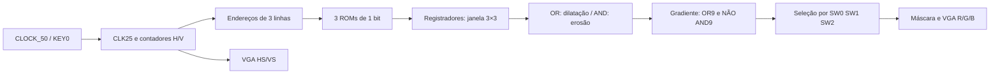
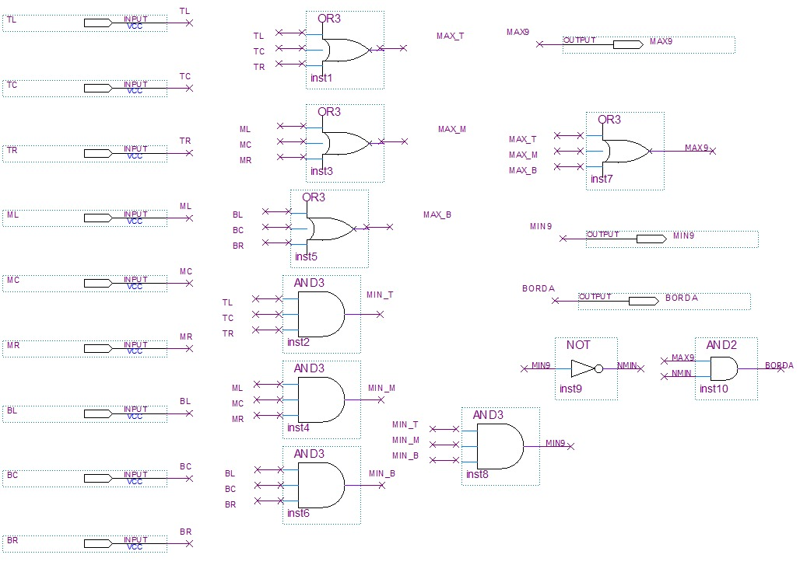
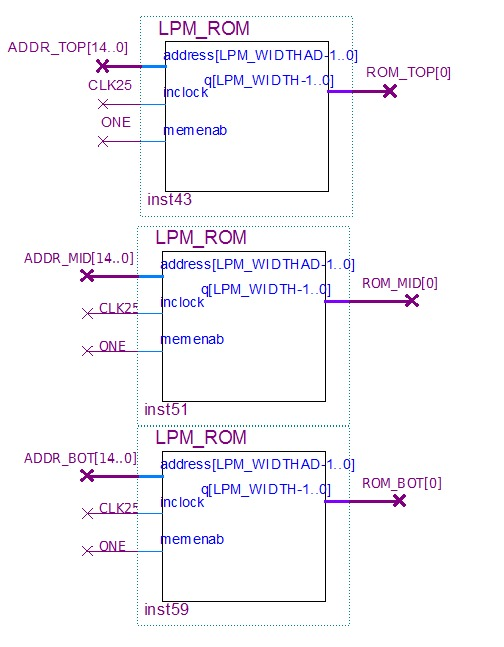
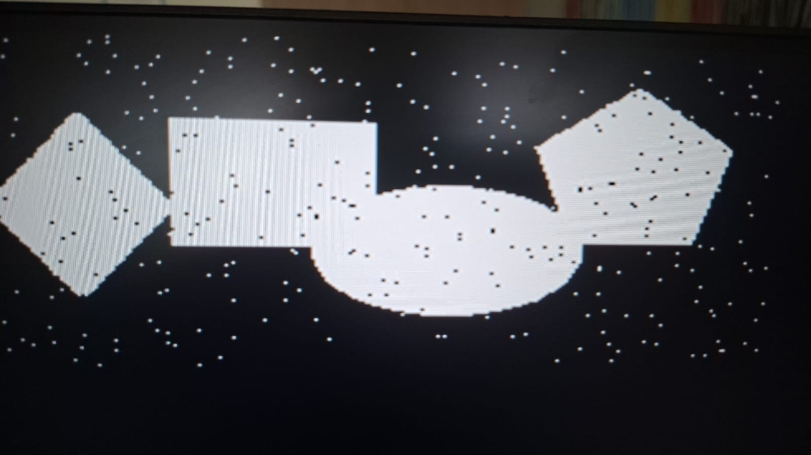

# Filtros morfológicos 3×3 em FPGA com saída VGA

Projeto acadêmico de **Sistemas Digitais — Engenharia de Computação, UFSCar (2026)**. A implementação realiza filtragem **binária** de uma imagem armazenada em ROM, utilizando circuitos esquemáticos do Quartus II e exibindo o pixel resultante por VGA.

> **Projeto exclusivamente esquemático:** não há módulos Verilog nem VHDL autorais no arquivo original. As instâncias de `LPM_COUNTER`, `LPM_ROM`, `LPM_COMPARE`, `LPM_ADD_SUB`, flip-flops e portas lógicas são componentes do Quartus.

## Identificação

| Propriedade | Valor extraído dos arquivos |
|---|---|
| Placa | **Terasic DE1 clássica**, FPGA Cyclone II `EP2C20F484C7` |
| Ambiente de referência | **Quartus II 13.0 SP1** |
| Projeto | [`DE1_Filtro.qpf`](projeto/DE1_Filtro.qpf), revisão/topo `DE1_Filtro` |
| Esquemático principal | [`DE1_Filtro.bdf`](projeto/DE1_Filtro.bdf) |
| Esquemático auxiliar de estudo | [`Filtro3x3_Referencia.bdf`](projeto/Filtro3x3_Referencia.bdf) |
| Imagem armazenada | [`Imagem_Ruidosa_DE1.mif`](projeto/Imagem_Ruidosa_DE1.mif), **32768 × 1 bit** |
| Saída | VGA, canais RGB de quatro bits, HS/VS |
| Entrada | `CLOCK_50`, `KEY[0]`, `SW[0..2]` |

## O que o circuito faz

Cada ROM lê uma linha distinta da mesma matriz binária. Dois flip-flops adicionais por linha conservam os pixels anteriores, formando nove amostras. A dilatação usa OR dos nove bits; a erosão usa AND; o gradiente morfológico binário usa `OR9 AND (NOT AND9)`.

## Modos selecionados pelas chaves

| SW0 | SW2 | SW1 | Imagem enviada à saída |
|:---:|:---:|:---:|---|
| 0 | X | X | Pixel original (`PIX_MID_C`) |
| 1 | 0 | 0 | Dilatação: `MAX9` |
| 1 | 0 | 1 | Erosão: `MIN9` |
| 1 | 1 | X | Gradiente morfológico: `MAX9 AND NOT MIN9` |

`KEY[0]` é a entrada de reinicialização ativa em nível baixo. A seleção é definida pelos rótulos e pelas portas presentes no arquivo `.bdf`.

## Repositório e tutorial

| Capítulo | Conteúdo |
|---|---|
| [01 — Introdução](docs/01-introducao.md) | Finalidade, hardware e processamento de imagem binária |
| [02 — Arquitetura](docs/02-arquitetura.md) | Organização dos módulos e principais sinais |
| [03 — Temporização VGA](docs/03-vga.md) | Contadores, 25 MHz, HS/VS e janela de imagem |
| [04 — ROM e endereços](docs/04-memoria.md) | Arquivo MIF e leitura de linhas |
| [05 — Janela 3×3](docs/05-janela.md) | Registradores, sincronização e nove pixels |
| [06 — Filtros e seletores](docs/06-filtros.md) | Dilatação, erosão, gradiente e tabela de chaves |
| [07 — Saídas](docs/07-saida.md) | Máscara da imagem, VGA e pinos |
| [08 — Reprodução no Quartus](docs/08-reproducao.md) | Abertura, configurações, compilação e placa |
| [09 — Verificações e limites](docs/09-validacao.md) | Resultados verificáveis e limites dos testes |

## Fotografias do esquemático

As **12 fotografias originais** do circuito foram organizadas na [galeria de diagramas](fotos_do_diagrama/README.md). As imagens ajudam a acompanhar os elementos apresentados nos capítulos técnicos.

## Resultados observados no monitor

As fotografias da prática mostram a imagem original e os resultados visualmente compatíveis com **erosão, dilatação e gradiente morfológico**. Os registros estão na [galeria de resultados VGA](resultados_vga/README.md), junto às imagens em resolução original.

A identificação dos modos baseia-se no efeito visível de cada operação; as fotografias não mostram as posições das chaves no momento do registro.

## Reproduzir

1. Baixar/clonar este repositório; manter juntos `DE1_Filtro.qpf`, os dois `.bdf`, o `.qsf` e o `.mif`.
2. Abrir [`projeto/DE1_Filtro.qpf`](projeto/DE1_Filtro.qpf) no Quartus II 13.0 SP1 e conferir **Cyclone II EP2C20F484C7** e **top-level `DE1_Filtro`**.
3. Inspecionar as atribuições de pinos em [`DE1_Filtro.qsf`](projeto/DE1_Filtro.qsf).
4. Executar **Processing → Start Compilation**. Somente após uma compilação bem-sucedida, gerar/gravar o `.sof` no Programmer.
5. Utilizar as chaves conforme a tabela de modos. Ver [instruções completas](docs/08-reproducao.md).
