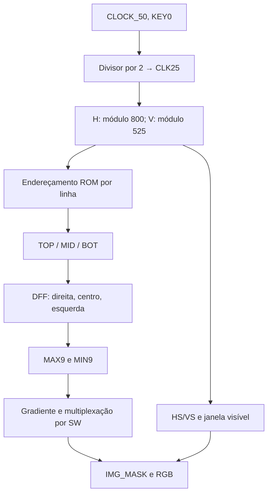

# 02 — Arquitetura do circuito

## Visão geral

O projeto não é organizado em módulos Verilog. O próprio [`DE1_Filtro.bdf`](../projeto/DE1_Filtro.bdf) contém os componentes de varredura, endereçamento, memória, formação da janela e filtros. [`Filtro3x3_Referencia.bdf`](../projeto/Filtro3x3_Referencia.bdf) mostra separadamente uma implementação de referência de máximos e mínimos lógicos 3×3; o topo principal já contém portas equivalentes.

## Sinais principais

| Sinal | Origem e finalidade |
|---|---|
| `CLK25` | Q do flip-flop com realimentação inversora; cadência nominal de 25 MHz |
| `H[9..0]`, `V[9..0]` | Contadores de período 800 e 525 |
| `VGA_HS`, `VGA_VS` | Pulsos de sincronismo ativo-baixo |
| `ADDR_TOP/MID/BOT[14..0]` | Endereços das três ROMs |
| `PIX_TOP/MID/BOT_{R,C,L}` | Nove amostras para filtro |
| `MAX9` e `MIN9` | OR e AND das nove amostras |
| `GRADIENT` | `MAX9 AND (NOT MIN9)` |
| `FILTER`, `PROC`, `SELECTED`, `PIXEL` | Cascata de seleção e máscara da imagem |

## Fluxo de dados

Os bits originais são obtidos a partir de ROMs sincronizadas com `CLK25`. A combinação sequencial/combinacional forma a vizinhança, e o circuito seleciona a saída. O bit `PIXEL` dirige os canais do conversor RGB da porta VGA.

---
[Anterior](01-introducao.md) · [Índice](../README.md#repositório-e-tutorial) · [Próximo: VGA](03-vga.md)
