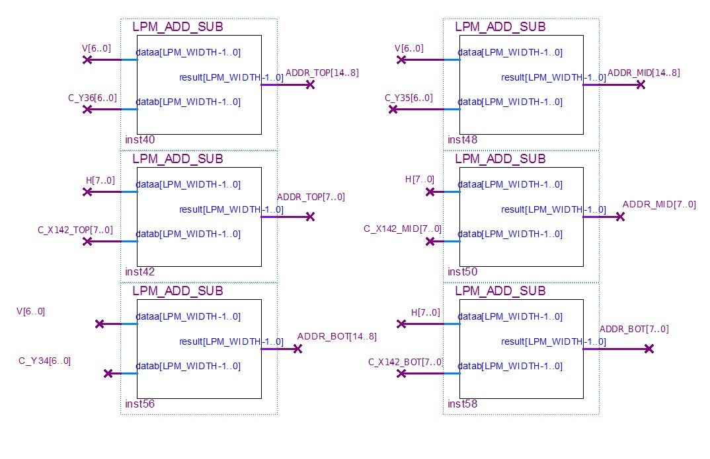
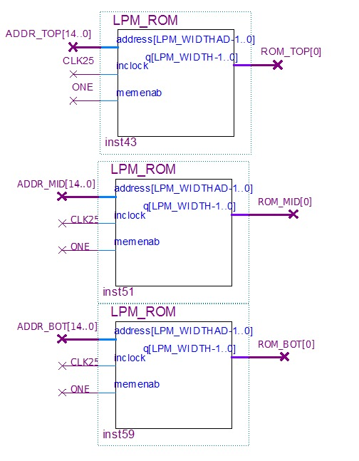

# 04 — Memória ROM e cálculo de endereços

## Arquivo MIF

O arquivo [`Imagem_Ruidosa_DE1.mif`](../projeto/Imagem_Ruidosa_DE1.mif) tem `WIDTH=1`, `DEPTH=32768`, endereços e dados em hexadecimal. O conteúdo representa **32768 posições binárias**. Uma interpretação natural para a matriz é **256 colunas × 128 linhas** (8 bits para X e 7 para Y).

Nos dados presentes no repositório, **10737 posições estão em 1** e **22031 estão em 0**. Essas contagens se referem ao conteúdo da memória, não a uma fotografia capturada do VGA.

## Três linhas paralelas

Há três instâncias de `LPM_ROM` de largura 1, cada uma com endereço de 15 bits e o mesmo arquivo MIF. Os endereços recebem os nomes `ADDR_TOP`, `ADDR_MID` e `ADDR_BOT`.

| Linha | Parte superior do endereço (7 bits) | Parte inferior (8 bits) |
|---|---|---|
| TOP | `V[6..0] - 36` | `H[7..0] - 142` |
| MID | `V[6..0] - 35` | `H[7..0] - 142` |
| BOT | `V[6..0] - 34` | `H[7..0] - 142` |

Os cálculos usam `LPM_CONSTANT` e `LPM_ADD_SUB`, configurados para subtração sem sinal. O endereço pode ser descrito como `(linha << 8) | coluna`, pois as duas partes ocupam sete e oito bits, respectivamente.

## Registros do esquemático

**Ajuste e composição dos endereços:**

**Três instâncias da memória ROM:**

## Portas de validade

Os sinais `VALID_Y_TOP`, `VALID_Y_MID` e `VALID_Y_BOT` controlam a validade dos pixels em suas faixas verticais. `READ_H_VALID` determina a faixa horizontal de leitura (142 a 397), e um flip-flop produz `READ_H_DELAYED` para acompanhar a latência da ROM.

Os três resultados das ROMs passam por portas AND de validação, gerando `PIX_TOP_R`, `PIX_MID_R` e `PIX_BOT_R`.

---
[Anterior](03-vga.md) · [Índice](../README.md#repositório-e-tutorial) · [Próximo: janela 3×3](05-janela.md)
