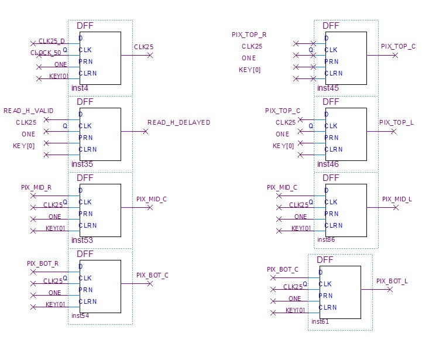

# 05 — Construção da vizinhança 3×3

Cada leitura da ROM produz um pixel à direita da janela (`*_R`). Dois flip-flops tipo D por linha, acionados por `CLK25`, deslocam amostras para o centro (`*_C`) e para a esquerda (`*_L`). O esquema principal utiliza **seis DFF para essas três linhas**, além de outros flip-flops de temporização.

```text
        Esquerda      Centro       Direita
 TOP    PIX_TOP_L   PIX_TOP_C   PIX_TOP_R
 MID    PIX_MID_L   PIX_MID_C   PIX_MID_R
 BOT    PIX_BOT_L   PIX_BOT_C   PIX_BOT_R
```

Um dos pixels centrais, `PIX_MID_C`, representa a seleção sem filtragem; os outros oito constituem sua vizinhança.

## Registradores da janela



## Registro temporal

A cadeia da linha superior segue `PIX_TOP_R → DFF → PIX_TOP_C → DFF → PIX_TOP_L`. As linhas média e inferior seguem o mesmo padrão. O acesso simultâneo às três ROMs permite obter linhas diferentes do mesmo arquivo de imagem.

## Exemplo de interpretação

Para a vizinhança binária abaixo, o centro vale 1, a dilatação vale 1, a erosão vale 0 e o gradiente vale 1:

```text
0 0 0
0 1 0
0 0 0
```

Essa demonstração é apenas um exemplo matemático; não é uma simulação do circuito. A real sincronização entre ROM, DFF e varredura precisa ser confirmada pela ferramenta de síntese/simulação.

---
[Anterior](04-memoria.md) · [Índice](../README.md#repositório-e-tutorial) · [Próximo: filtros](06-filtros.md)
