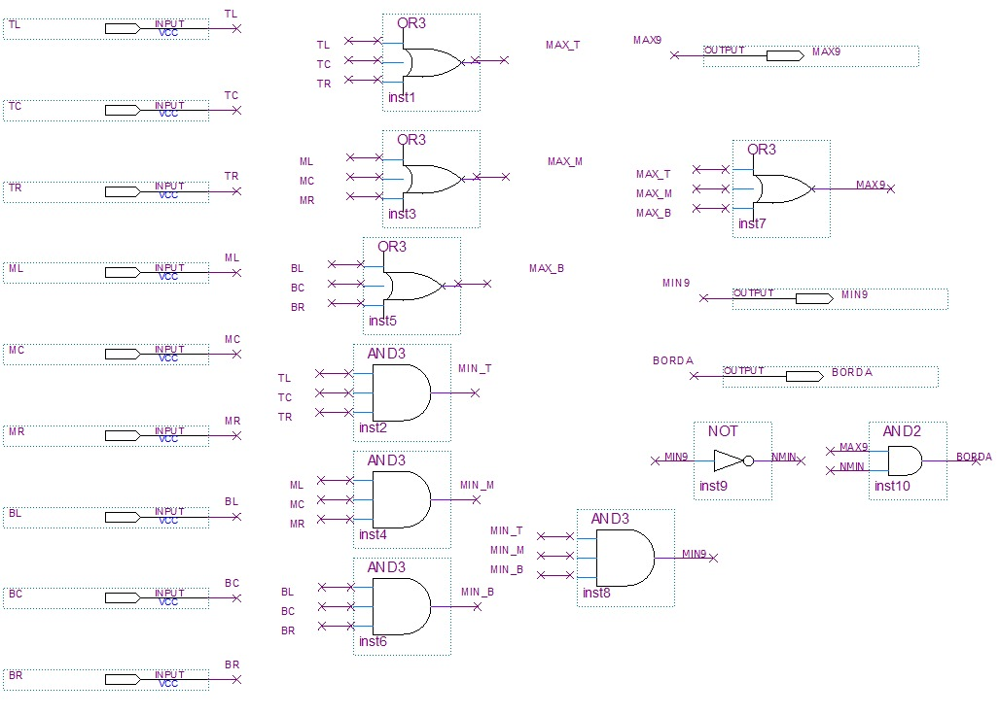
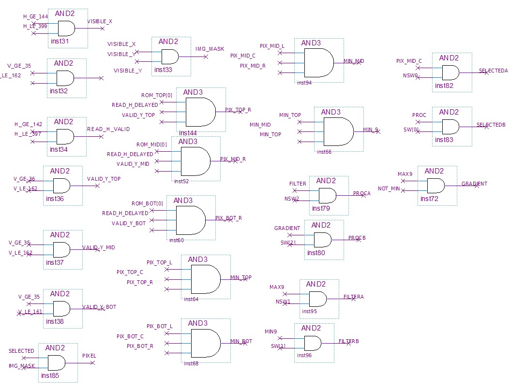

# 06 — Filtros morfológicos e seleção pelas chaves

## Dilatação binária

Em uma vizinhança 3×3, **dilatação** vale 1 quando **pelo menos um** dos nove bits vale 1. O circuito forma OR por linha (`MAX_TOP`, `MAX_MID`, `MAX_BOT`) e um OR adicional para `MAX9`.

**Equação:** `D = p1 OR p2 OR ... OR p9 = MAX9`.

## Erosão binária

A **erosão** vale 1 somente quando **todos** os nove pixels valem 1. O circuito usa AND por linha e uma etapa final `MIN9`.

**Equação:** `E = p1 AND p2 AND ... AND p9 = MIN9`.

## Gradiente morfológico

A porta NOT produz `NOT_MIN` e uma AND gera **`GRADIENT = MAX9 AND NOT_MIN`**, isto é, `D AND (NOT E)`. Em uma imagem binária, esse cálculo destaca vizinhanças que têm tanto pixels 0 quanto pixels 1; é uma forma lógica do gradiente morfológico.

## Esquemáticos da filtragem

**Circuito de referência com nove entradas:**



**Portas AND de validação e seleção:**



## Exatamente como as chaves selecionam

O circuito forma as expressões:

```text
FILTER = (MAX9 AND NOT SW1) OR (MIN9 AND SW1)
PROC = (FILTER AND NOT SW2) OR (GRADIENT AND SW2)
SELECTED = (PIX_MID_C AND NOT SW0) OR (PROC AND SW0)
PIXEL = SELECTED AND IMG_MASK
```

| SW0 | SW2 | SW1 | Resultado |
|---|---|---|---|
| 0 | X | X | Imagem original |
| 1 | 0 | 0 | Dilatação (OR9) |
| 1 | 0 | 1 | Erosão (AND9) |
| 1 | 1 | X | Gradiente (OR9 e não AND9) |

**Importante:** em `SW2=1`, a escolha de `SW1` não altera o tipo de processamento. Em `SW0=0`, a saída ignora os dois modos de processamento.

## Circuito de referência

O esquemático [`Filtro3x3_Referencia.bdf`](../projeto/Filtro3x3_Referencia.bdf) apresenta a mesma ideia de OR/AND por três linhas, incluindo a composição final de `MAX9` e `MIN9`.

---
[Anterior](05-janela.md) · [Índice](../README.md#repositório-e-tutorial) · [Próximo: saída VGA](07-saida.md)
