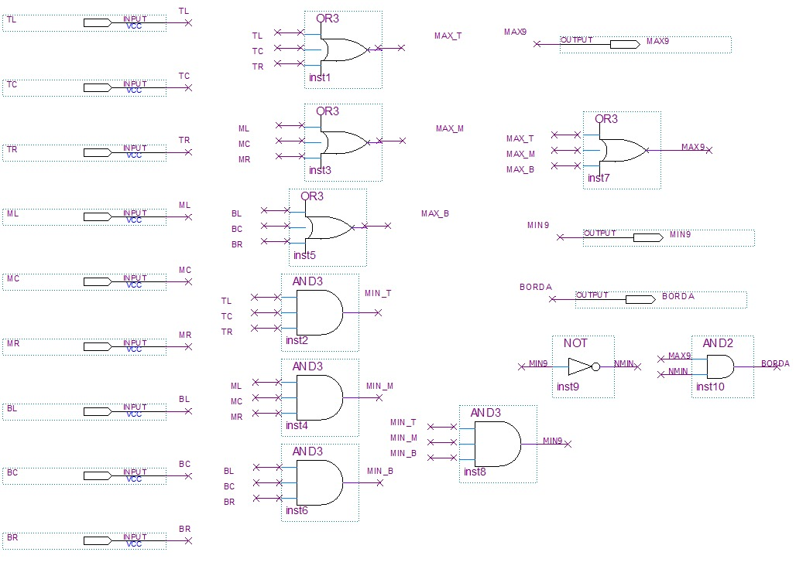
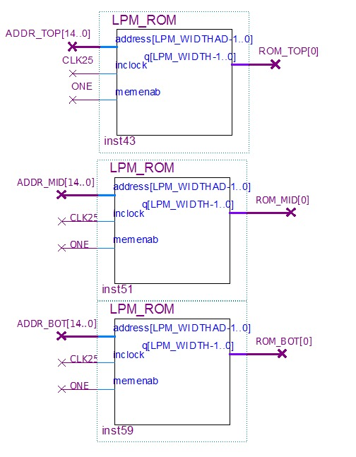
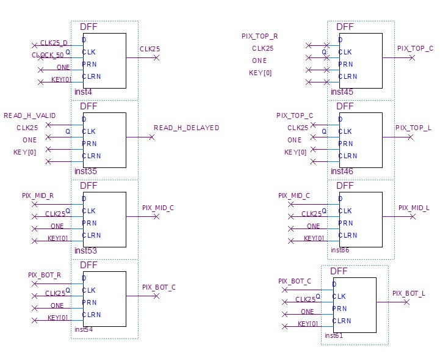
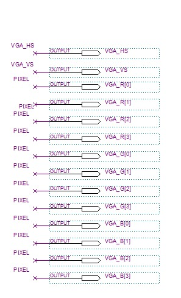

# Fotografias do diagrama esquemático

As **12 capturas coloridas originais** do editor esquemático estão preservadas nesta pasta, sem alterações nos bytes recebidos. Os nomes são mantidos para facilitar a conferência com os registros do experimento.

| Captura | Conteúdo |
|---|---|
| [Entrada_VCC.jpeg](Entrada_VCC.jpeg) | Entradas físicas, VCC e chaves |
| [Contadores.jpeg](Contadores.jpeg) | Contadores horizontal e vertical |
| [Comparadores.jpeg](Comparadores.jpeg) | Comparadores da varredura VGA |
| [Constantes_Comparacao.jpeg](Constantes_Comparacao.jpeg) | Constantes de comparação e endereçamento |
| [ROMs.jpeg](ROMs.jpeg) | Três instâncias de ROM |
| [add_subs.jpeg](add_subs.jpeg) | Blocos somadores/subtratores de endereços |
| [FFs.jpeg](FFs.jpeg) | Flip-flops e formação da janela |
| [Filtro3x3.jpeg](Filtro3x3.jpeg) | Circuito de referência da janela 3×3 |
| [ANDs.jpeg](ANDs.jpeg) | Portas AND e validação de pixels |
| [ORs.jpeg](ORs.jpeg) | Portas OR e composição de operações |
| [Inversores.jpeg](Inversores.jpeg) | Inversores e sinais auxiliares |
| [Saidas.jpeg](Saidas.jpeg) | Saídas RGB e sincronismos VGA |

## Visualização rápida

**Circuito de referência 3×3**

**Memórias ROM**

**Registradores de pixels**

**Saídas VGA**

## Versões de alto contraste

A subpasta [alto_contraste](alto_contraste/) reúne cópias binarizadas em preto e branco, úteis para impressão e leitura dos diagramas; **os JPEGs desta pasta são os arquivos coloridos originais**.

[Voltar ao README do projeto](../README.md)
