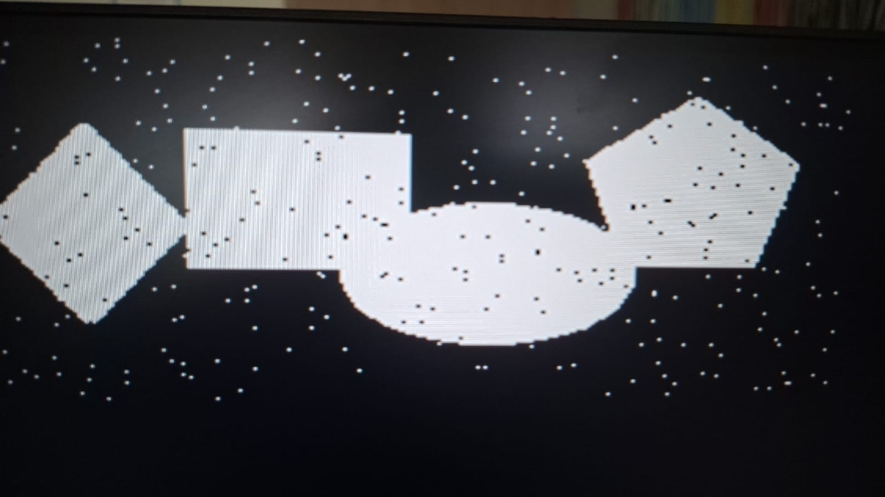
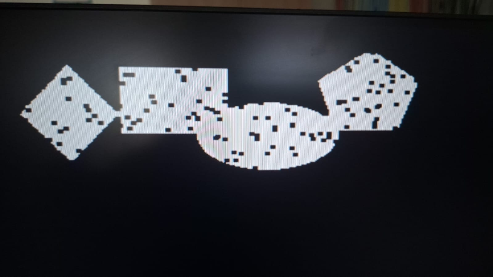
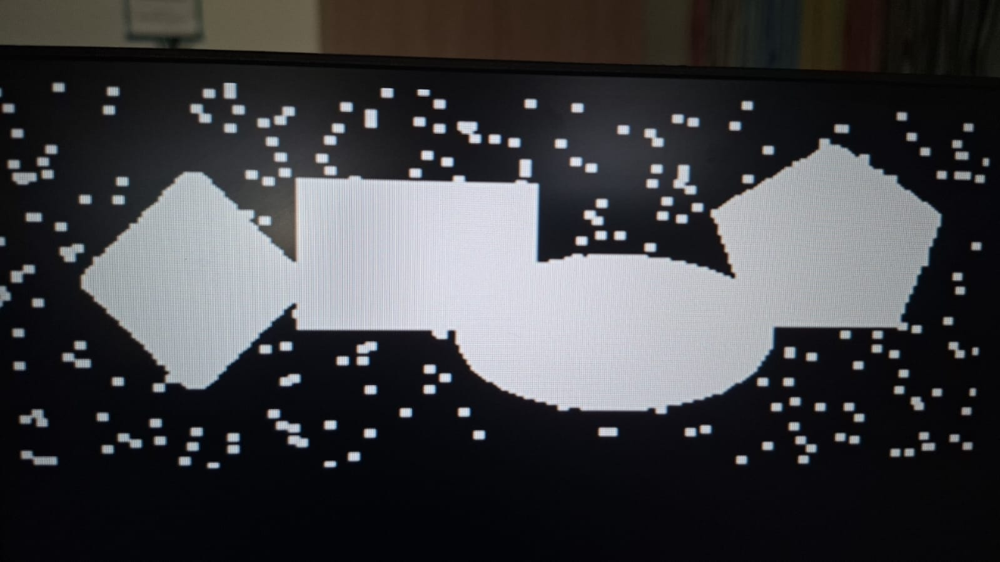
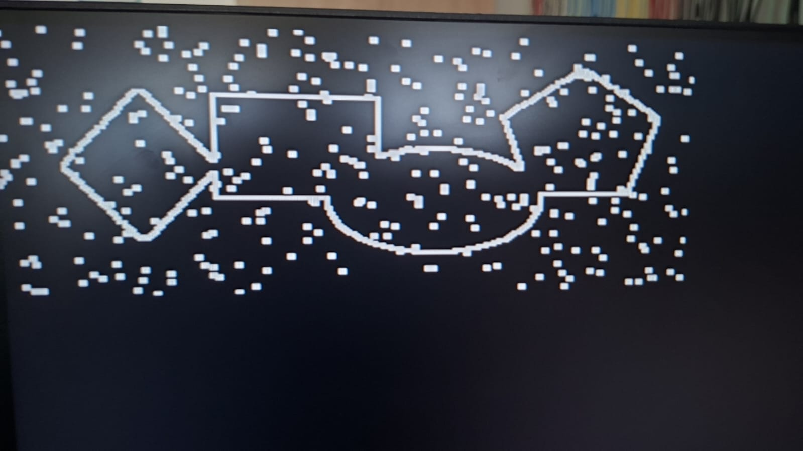

# Resultados dos filtros no monitor VGA

Fotografias originais da prática de Sistemas Digitais (2026). Estes registros mostram a mesma composição de figuras em quatro situações de processamento. As imagens foram publicadas sem alterações de conteúdo ou compressão adicional.

| Imagem | Observação visual |
|---|---|
| [Original.jpeg](Original.jpeg) | Formas brancas com pontos escuros internos e ruído claro sobre o fundo |
| [Erosao.jpeg](Erosao.jpeg) | Redução das regiões brancas e realce dos espaços escuros |
| [Dilatacao.jpeg](Dilatacao.jpeg) | Expansão das regiões brancas e dos pontos claros |
| [Gradiente.jpeg](Gradiente.jpeg) | Contornos das figuras destacados e transições do ruído evidenciadas |

### Imagem original

### Erosão

### Dilatação

### Gradiente morfológico

**Nota:** o modo associado a cada imagem foi identificado pelas características visuais, em comparação com as operações documentadas no circuito. As fotografias não registram os estados das chaves durante cada captura.

[Voltar ao README](../README.md) · [Diagramas esquemáticos](../fotos_do_diagrama/README.md)
